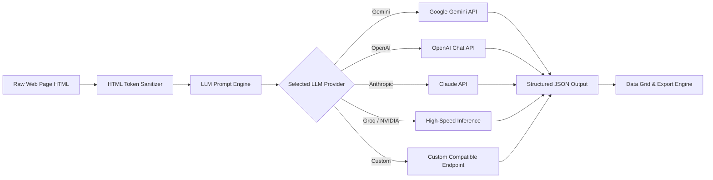

# WebScraperSuite (WebScraper Pro)

[](https://dotnet.microsoft.com/)
[](https://docs.microsoft.com/dotnet/csharp/)
[](https://playwright.dev/)
[](https://developer.microsoft.com/microsoft-edge/webview2/)
[](https://www.microsoft.com/windows)
[](https://github.com/Omatsulijoshua/WebScraperSuite/releases)

An enterprise-grade, modular web scraping, asset harvesting, site mirroring, and live monitoring suite built with **.NET 9**, **C#**, **Windows Forms**, **Microsoft Playwright**, **WebView2**, **HtmlAgilityPack / Fizzler**, **ASP.NET Core**, and **Node.js**.

---

## 🖥️ A GUI-First, Professional Desktop Solution for Web Scraping

> **Say goodbye to brittle CLI scripts, terminal errors, and coding boilerplate.**
>
> Most web scraping tools expect you to write Python scripts, configure headless drivers from command prompts, and debug selectors through constant trial and error. **WebScraperSuite (WebScraper Pro)** is purpose-built as an intuitive, high-performance **graphical desktop workstation** that empowers data analysts, researchers, marketers, and developers to harvest data visually:
>
> - **🖱️ Visual Point-and-Click Element Picking:** Powered by Chromium WebView2, you can hover over web pages, see live high-contrast DOM highlight outlines, and click on any element to auto-generate rock-solid CSS and XPath selectors.
> - **👀 Live Visual Feedback & Previews:** Inspect raw input snapshots, rendered DOM trees, live DataGridView rows, and real-time activity consoles side-by-side without leaving the app.
> - **🔐 Interactive Human Authentication (No Brittle Hacks):** When websites require logins, 2FA/MFA, or human verification, click **Approve / Login** to launch a real headed browser window, sign in normally, and pull the authenticated page state directly into your scraper.
> - **🤖 Zero-Code AI Autopilot Extraction:** Leverage cutting-edge LLMs (Gemini, OpenAI, Claude, Groq, Grok) with one click to intelligently analyze page layouts, detect repeated list rows, and auto-populate structured tables without manually configuring selectors.
> - **🎨 Sleek Customizable Theme System:** Switch effortlessly between **Dark (Default)**, **Light**, **Midnight (AMOLED)**, and **Emerald Dark** palettes with live real-time preview.
> - **📦 6 Dedicated Workspaces in a Unified Hub:** Seamlessly navigate between Deep Structured Scraping, Visual Element Picking, Bulk Media Harvesting, Offline Website Cloning, Differential Live Monitoring, and Local Webhook Receivers.

---

## 📥 Download Pre-Compiled Windows Executables (.exe)

> **No developer environment, command line, or .NET SDK installation required!**
>
> You can download the latest standalone, self-contained Windows release package directly from the GitHub Releases page:
>
> 🚀 **[Download Latest Release (`WebScraperSuite-Windows-x64.zip`)](https://github.com/Omatsulijoshua/WebScraperSuite/releases/latest)**

### How to Run:
1. Go to the [Releases](https://github.com/Omatsulijoshua/WebScraperSuite/releases) page and download **`WebScraperSuite-Windows-x64.zip`** under the **Assets** section.
2. Extract the downloaded `.zip` file into any folder on your computer (e.g., `C:\WebScraperPro`).
3. Double-click **`WebScraperPro.exe`** (or `Scraper.Advanced.WinForms.exe`) to start the application.
4. From the Welcome dashboard, you can open the **Advanced Deep Scraper** or click **Launch App** on any card to immediately open the **Visual Element Picker**, **Media Scraper**, **Website Cloner**, **Automatic Scraper**, or **Webhook Receiver**.

---

## Table of Contents

- [🖥️ A GUI-First Pro Solution](#️-a-gui-first-professional-desktop-solution-for-web-scraping)
- [📥 Download Pre-Compiled Executables (.exe)](#-download-pre-compiled-windows-executables-exe)
- [Key Highlights](#key-highlights)
- [Architecture & Solution Overview](#architecture--solution-overview)
- [Suite Modules & Features](#suite-modules--features)
  - [1. Advanced Deep Scraper](#1-advanced-deep-scraper-scraperadvancedwinforms)
  - [2. Visual Element Picker](#2-visual-element-picker-scraperpickerwinforms)
  - [3. Media Scraper](#3-media-scraper-scrapermediawinforms)
  - [4. Website Cloner & Offline Archiver](#4-website-cloner--offline-archiver-scrapersiteclonerwinforms)
  - [5. Automatic Scraper & Real-Time Monitoring](#5-automatic-scraper--real-time-monitoring-scraperautomaticwinforms)
  - [6. Dual Webhook Receivers](#6-dual-webhook-receivers-aspnet-core--nodejs)
  - [7. Core Shared Engine](#7-core-shared-engine-scrapercore)
  - [8. Anti-Bot & Bypass Layer](#8-anti-bot--bypass-layer-scraperbypass)
  - [9. REST API & UI Client](#9-rest-api--ui-client-scraperapi--scraperui)
- [Browser Engine & Authentication Strategy](#browser-engine--authentication-strategy)
- [AI Autopilot & Intelligent Layout Analysis](#ai-autopilot--intelligent-layout-analysis)
- [Prerequisites & System Requirements](#prerequisites--system-requirements)
- [Getting Started & Installation](#getting-started--installation)
- [Configuration & Settings](#configuration--settings)
- [Workflow Examples](#workflow-examples)
- [Project Directory Layout](#project-directory-layout)
- [Ethical Scraping & Compliance](#ethical-scraping--compliance)
- [Contributing & License](#contributing--license)

---

## Key Highlights

- **Dual-Engine Scraping:** Switch between blazing-fast headless HTTP fetching (`HttpClient` + `HtmlAgilityPack` + `Fizzler`) for static web pages and headless/headed browser execution (`Microsoft Playwright`) for JavaScript-rendered SPAs (Angular, React, Vue, Blazor).
- **Chrome DevTools Protocol (CDP) Attachment:** Seamlessly connect over CDP (`http://localhost:9222`) to your existing running Google Chrome session to reuse logged-in profiles, cookies, and local session storage.
- **Interactive Manual Approval Sessions:** Open a real, visible browser window directly from the app to complete authentication, multi-factor challenges (MFA/2FA), or interactive verification, then extract data directly from the authenticated DOM.
- **Visual Element Picker (WebView2):** Point-and-click DevTools-grade inspector that highlights DOM nodes on hover, resolves optimal CSS selectors and XPath queries, stores selector histories, and transfers them across suite tools via inter-process file handoff.
- **Multi-Provider AI Autopilot:** Integrated LLM extraction supporting **Google Gemini**, **OpenAI**, **Anthropic Claude**, **Groq**, **xAI Grok**, **OpenRouter**, **NVIDIA NIM**, and OpenAI/Anthropic-compatible custom endpoints to extract structured JSON data, layout schemas, and media assets.
- **Deep Pagination & Auto-Scroll:** Smart infinite scroll simulation with step increments, lazy-load detection (`data-src`, `data-lazy-src`, `srcset`), and multi-page range traversal.
- **Multi-Format Export Engine:** Export structured dataset tables to **CSV** (via `CsvHelper`), formatted indented **JSON**, or clean **Excel (.xls)** tables.
- **Full Website Cloner:** Crawl same-origin pages recursively, download all linked media and static assets with SHA-256 de-duplication, and rewrite document links into relative paths for local offline browsing.
- **Differential Live Monitoring:** Poll web pages on defined intervals (from 2 seconds to 1 hour), compute cryptographic content hashes (SHA-256), and dispatch structured payloads to webhook endpoints only when content changes.
- **Dual Webhook Infrastructure:** Ready-to-run webhook logging services in both **ASP.NET Core Minimal API** and **Node.js Express**, storing events in append-only NDJSON format.

---

## Architecture & Solution Overview

WebScraperSuite is organized into clean, modular .NET 9 projects along with a companion Node.js service:

```
WebScraperSuite.sln
│
├── Scraper.Advanced.WinForms        # Suite hub, Welcome dashboard, Deep workspace & configuration
├── Scraper.Picker.WinForms          # WebView2 interactive click-to-pick visual selector tool
├── Scraper.Media.WinForms           # Media discovery, pagination crawler, and multi-threaded downloader
├── Scraper.SiteCloner.WinForms      # Offline website mirroring, asset downloader & link rewriter
├── Scraper.Automatic.WinForms       # Interval-based differential scraper & webhook transmitter
│
├── Scraper.Core                     # Shared engine: Playwright, HTTP, AI, Export, Parser, Settings
├── Scraper.Bypass                   # Human simulation, session management, bot detection heuristics
│
├── Scraper.WebhookReceiver          # ASP.NET Core Minimal API webhook receiver (Port 3001)
├── webhook-receiver-node            # Node.js/Express alternative webhook receiver (Port 3001)
│
├── Scraper.API                      # ASP.NET Core Web API with Swagger/OpenAPI documentation
└── Scraper.UI                       # Lightweight alternative WinForms frontend for Scraper.API
```

---

## Suite Modules & Features

### 1. Advanced Deep Scraper (`Scraper.Advanced.WinForms`)
The primary structured data extraction workstation.
- **Central Welcome Hub (`WelcomeForm`):** Serves as the suite launcher, providing one-click access to all 6 tools and the global configuration dialog.
- **Dual Workspace View:** Features an **Input tab** (URL or raw HTML input, site type selection, selector mode, live DOM snapshot preview) and an **Output tab** (real-time data grid, extraction activity logs, page progress tracking, and multi-format export).
- **Custom & Auto-Detected Selectors:** Automatically analyzes HTML to detect tables (`table tbody tr`) and card layouts (`.product-card`, `.listing-card`, `article`), or define multi-column extraction plans with custom CSS or XPath selectors.
- **Multi-Page Pagination:** Supports `This page`, `All pages`, or customizable page ranges (e.g., pages 1 through 10) with automatic URL pagination rewriting.
- **Automated Viewport Scrolling:** Handles infinite feeds and dynamic Ajax content loading through customizable scroll cycles.
- **Instant Export:** Export extracted data tables to CSV, JSON, or Excel.

### 2. Visual Element Picker (`Scraper.Picker.WinForms`)
Interactive DOM inspector powered by Microsoft WebView2.
- **Interactive Inspect Mode:** Hover over any web element to display high-contrast outline borders and tag badges in real time.
- **One-Click Capture:** Click any element to generate its clean, specific CSS selector and absolute/relative XPath query.
- **Selector History:** Keeps track of all picked elements during a session for rapid multi-field mapping.
- **Inter-Process Transfer:** Writes selected queries to a shared local cache (`%TEMP%\WebScraperPro\selector-transfer.json`), automatically importing picked selectors into the Advanced Scraper or Automatic Scraper without manual copy-pasting.

### 3. Media Scraper (`Scraper.Media.WinForms`)
Dedicated multimedia discovery and batch downloader.
- **Broad Asset Detection:** Discovers images (``, `data-src`, `data-lazy-src`, `data-original`, `srcset`), video files (`<video>`, `<source>`), and audio streams (`<audio>`, `<source>`, `.mp3`).
- **Dynamic DOM Injection:** Intercepts media rendered during Playwright infinite scroll cycles and compiles them into a unified harvest archive.
- **Asset Filtering & Pagination:** Filter by media type, specify page ranges, and preview URLs, status, and filenames in a live DataGridView.
- **Asynchronous Disk Streaming:** Downloads large asset batches directly to a specified destination directory with progress indicators.

### 4. Website Cloner & Offline Archiver (`Scraper.SiteCloner.WinForms`)
Offline website downloader and mirroring tool.
- **Recursive Same-Origin Crawling:** Traverses site hierarchies up to a configurable maximum page limit while keeping external origins excluded.
- **Asset Mirroring:** Downloads stylesheets, JavaScript files, images, icons, and embedded media, hashing file URLs with SHA-256 to prevent duplicate downloads and collisions.
- **Link Rewriting Engine:** Modifies document `href`, `src`, and `poster` attributes to point to relative local disk paths, enabling complete offline navigation directly via `index.html`.

### 5. Automatic Scraper & Real-Time Monitoring (`Scraper.Automatic.WinForms`)
Continuous monitoring and webhook notification service.
- **Interval Polling:** Continuously scrapes a target URL at user-defined intervals (from 2 seconds to 3600 seconds).
- **Differential Content Hashing:** Calculates a SHA-256 hash of extracted fields to detect real data modifications, preventing redundant webhook broadcasts.
- **Transmission Profiles (`TransmissionSettingsForm`):** Configure webhook headers, metadata flags (`sourceUrl`, `capturedAtUtc`, `contentHash`, `fieldMetadata`), and nested JSON output structures (`dataRootKey`).
- **Live Event Log:** In-app telemetry list showing polling timestamps, HTTP status codes, and webhook delivery confirmations.

### 6. Dual Webhook Receivers (ASP.NET Core & Node.js)
Turnkey webhook ingestion endpoints ready for local or remote deployment.
- **ASP.NET Core Receiver (`Scraper.WebhookReceiver`):** Minimal API service running on `http://localhost:3001` with endpoints:
  - `GET /health` – Health check and status timestamp.
  - `POST /webhook/live-update` – Receives and appends incoming payloads to `data/events.ndjson`.
  - `GET /events` – Streams parsed JSON events.
- **Node.js Receiver (`webhook-receiver-node`):** Express-based server providing identical endpoints and NDJSON logging for cross-platform deployments.

### 7. Core Shared Engine (`Scraper.Core`)
The backbone library shared across all applications:
- **`PlaywrightService`:** Multi-browser management (Chrome, Edge, Firefox, WebKit, Chromium, Opera, Brave, Vivaldi), CDP connectivity, SPA loading heuristics (monitoring `#app`, spinners, data-tables, and active network connections), and viewport-stepping infinite auto-scroll.
- **`HttpScraperService`:** High-throughput `HttpClient` implementation configured with desktop browser user agents.
- **`AiService`:** Multi-LLM inference orchestrator with HTML token-optimization sanitization, supporting structured data extraction, media identification, and layout analysis.
- **`SiteCloneService`:** Page crawling, URL resolution, asset mapping, and relative link rewriting.
- **`SelectorHelper` & `HtmlParserHelper`:** CSS selection through Fizzler and XPath querying through HtmlAgilityPack.
- **`ExportService`:** Clean serialization to CSV, indented JSON, and Excel XML tables.

### 8. Anti-Bot & Bypass Layer (`Scraper.Bypass`)
Ethical browser automation and session resilience utilities:
- **`ProtectionDetector`:** Heuristically detects Cloudflare challenges, CAPTCHAs, bot protection walls, and "Access Denied" screens.
- **`HumanBehaviorService`:** Implements natural mouse paths, variable viewport scrolling, and realistic operational delays.
- **`BrowserSessionService` & `SessionManager`:** Manages persistent browser contexts, cookies, and local session caches.

### 9. REST API & UI Client (`Scraper.API` & `Scraper.UI`)
- **ASP.NET Core Web API:** Exposes endpoints for remote automation pipelines (e.g. `POST /api/scraper/scrape`), complete with Swagger documentation.
- **WinForms API Client (`Scraper.UI`):** Demonstrates consuming scraping endpoints asynchronously via `HttpClient` and visualizing results in a desktop interface.

---

## Browser Engine & Authentication Strategy

Modern web applications often guard data behind complex authentication systems, single-page client rendering, or bot verification screens. WebScraperSuite implements a dual approach:

### 1. Manual Approval Mode (Interactive Login)
Rather than attempting brittle automated CAPTCHA bypassing, WebScraperSuite provides **Manual Approval Mode**:
1. Click **Manual Approval** in any tool (Advanced Scraper, Media Scraper, Site Cloner, Automatic Scraper).
2. A headed, interactive browser window opens.
3. Authenticate manually, solve any 2FA/MFA or puzzle verifications, and navigate to the target data view.
4. Return to WebScraperSuite and click **Resume / Scrape Approved Session**. The suite extracts data directly from the authenticated DOM.

### 2. Chrome DevTools Protocol (CDP) Attachment
You can attach WebScraperSuite directly to your primary Google Chrome installation:
```powershell
chrome.exe --remote-debugging-port=9222 --user-data-dir="C:\ChromeProfile"
```
In WebScraperSuite's **Configuration**, select `Running Chrome (CDP 9222)`. The suite will immediately connect to your active browser context, maintaining all existing cookies, active logins, and browsing state.

---

## AI Autopilot & Intelligent Layout Analysis

WebScraperSuite includes an integrated **AI Service** that allows you to extract tabular data without writing CSS or XPath selectors:



### Supported AI Providers
| Provider | Default / Recommended Model | Authentication | Features |
| :--- | :--- | :--- | :--- |
| **Google Gemini** | `gemini-1.5-flash` / `gemini-2.5-flash` | Google AI Studio Key | Fast structured JSON output |
| **OpenAI** | `gpt-4o-mini` / `gpt-4o` | OpenAI API Key | Reliable JSON schema mode |
| **Anthropic** | `claude-3-5-sonnet-latest` | Anthropic API Key | Complex nested HTML analysis |
| **Groq** | `llama-3.3-70b-versatile` | Groq API Key | Ultra-low latency extraction |
| **OpenRouter** | `google/gemini-2.5-flash` | OpenRouter API Key | Multi-model routing |
| **xAI (Grok)** | `grok-2-1212` | xAI API Key | Conversational DOM reasoning |
| **NVIDIA NIM** | `nvidia/llama-3.1-nemotron-70b-instruct` | NVIDIA API Key | High-performance inference |
| **Custom / Other** | User-defined model | Custom Bearer Token | Private self-hosted / vLLM / Ollama |

---

## Prerequisites & System Requirements

- **Operating System:** Windows 10 (Version 1809+) or Windows 11 (64-bit).
- **.NET SDK:** [.NET 9.0 SDK](https://dotnet.microsoft.com/download/dotnet/9.0) or higher.
- **Web Browser:** Google Chrome, Microsoft Edge, or Playwright Chromium.
- **WebView2 Runtime:** Installed by default on modern Windows 10/11 installations; standalone installer available from Microsoft if needed.
- **Node.js (Optional):** Required only if running the Node.js webhook receiver (`webhook-receiver-node`).

---

## Getting Started & Installation

### Option A: Ready-to-Run Release (Recommended for End Users)
If you simply want to use WebScraperSuite on Windows without installing programming runtimes or compilers:
1. Navigate to the **[Releases](https://github.com/Omatsulijoshua/WebScraperSuite/releases)** page.
2. Download **`WebScraperSuite-Windows-x64.zip`** from the latest release assets.
3. Extract the ZIP folder to your desired location.
4. Launch **`WebScraperPro.exe`** (or `Scraper.Advanced.WinForms.exe`).

### Option B: Automated Local Release Packaging
If you have the .NET 9 SDK installed and want to build the entire standalone distribution locally:
```powershell
git clone https://github.com/Omatsulijoshua/WebScraperSuite.git
cd WebScraperSuite
.\build-release.ps1
```
This script compiles all 5 WinForms tools and the webhook receiver, bundles them into `./dist/WebScraperPro`, creates the `WebScraperPro.exe` convenience shortcut, installs Playwright Chromium, and packages everything into `./dist/WebScraperSuite-Windows-x64.zip` ready for upload to GitHub Release assets.

### Option C: Building & Running from Source (for Developers)

#### 1. Clone the Repository
```bash
git clone https://github.com/Omatsulijoshua/WebScraperSuite.git
cd WebScraperSuite
```

#### 2. Restore NuGet Packages & Build the Solution
```powershell
dotnet restore WebScraperSuite.sln
dotnet build WebScraperSuite.sln -c Release
```

#### 3. Install Playwright Browsers
After building, install the required Playwright browser binaries:
```powershell
pwsh Scraper.Core/bin/Release/net9.0/playwright.ps1 install
```
*(Alternatively, execute `playwright.ps1 install` in your target build output directory.)*

#### 4. Launch the Suite
You can launch the central suite hub from Visual Studio or the command line:
```powershell
dotnet run --project Scraper.Advanced.WinForms/Scraper.Advanced.WinForms.csproj
```
*(Or launch both the desktop workspace and the .NET webhook receiver using the included `WebScraperSuite.slnLaunch` configuration in Visual Studio 2022.)*

---

## Configuration & Settings

Global configuration is managed through the **Configuration** modal in `Scraper.Advanced.WinForms` and persisted to:
```text
%APPDATA%\WebScraperPro\settings.json
```

### Configuration Options
| Setting | Description | Default |
| :--- | :--- | :--- |
| **`Theme`** | UI color palette (`Dark`, `Light`, `Midnight`, `Emerald`) | `Dark` |
| **`ApiProvider`** | Selected LLM backend (`Gemini`, `OpenAI`, `Groq`, `Anthropic`, etc.) | `Gemini` |
| **`ApiModel`** | Specific model identifier (e.g. `gemini-1.5-flash`, `gpt-4o-mini`) | `gemini-1.5-flash` |
| **`ApiKey`** | API secret key for the selected provider | *(Empty)* |
| **`CustomEndpoint`**| Custom endpoint URL for private or self-hosted LLMs | *(Empty)* |
| **`PreferredBrowser`**| Browser used by Playwright (`Chrome`, `Edge`, `Firefox`, `CDP 9222`) | `Chrome` |
| **`EnableAutoScroll`**| Enable gradual viewport stepping and infinite scroll | `true` |
| **`MaxScrollLoops`** | Maximum scroll attempts per page | `5` |
| **`ApiTimeoutSeconds`**| Maximum wait time for AI inference responses | `100` |
| **`AutoSaveCsv / Json`**| Automatically persist extracted data tables on completion | `true` |

---

## Workflow Examples

### Example 1: Extracting an E-Commerce Catalog
1. Launch **Advanced Deep Scraper**.
2. Paste the target URL (e.g., `https://example.com/products`).
3. Set **Site Type** to `JavaScript` (for dynamic SPAs) or `Static`.
4. Check **Auto-Scroll** to capture lazy-loaded products.
5. In the **Fields Grid**, define column names and CSS selectors (e.g., Row: `.product-item`, Title: `h2.title`, Price: `.price`).
6. Click **Scrape Page** (or select **Page range** to crawl multiple pages).
7. Review the live output grid and click **Export Data** -> **CSV**.

### Example 2: Picking Selectors Visually
1. Launch **Element Picker**.
2. Navigate to your target web page in the embedded WebView2 browser.
3. If the site requires login, sign in normally.
4. Toggle **Inspect Mode** and click on any element (e.g. product card or pricing tag).
5. The picker displays the CSS selector and XPath query, saves it to history, and broadcasts it to the active scraper form.

### Example 3: Live Monitoring with Webhook Alerts
1. Open a terminal and start the webhook receiver:
   ```powershell
   dotnet run --project Scraper.WebhookReceiver/Scraper.WebhookReceiver.csproj
   # Or using Node.js:
   cd webhook-receiver-node && npm install && npm start
   ```
2. Launch **Automatic Scraper**.
3. Input the live page URL, target selector (e.g. `.live-score` or `#current-price`), and set the poll interval to `15` seconds.
4. Enter `http://localhost:3001/webhook/live-update` into the webhook URL box.
5. Click **Start Monitoring**. WebScraperSuite will poll the target page and dispatch payloads only when the content hash changes.

---

## Project Directory Layout

```text
WebScraperSuite/
├── Scraper.Advanced.WinForms/     # Primary desktop suite launcher & advanced workspace
│   ├── WelcomeForm.cs             # Suite hub & mode selection cards
│   ├── AdvancedWorkspaceForm.cs   # Multi-tab data extraction workspace
│   └── ConfigurationForm.cs       # AI keys, browser settings & auto-scroll options
├── Scraper.Picker.WinForms/       # Visual WebView2 point-and-click selector tool
│   └── ElementPickerForm.cs       # DOM element highlighter and selector generator
├── Scraper.Media.WinForms/        # Media crawler and multi-threaded downloader
│   └── MediaScraperForm.cs        # Media grid, filter options and download orchestrator
├── Scraper.SiteCloner.WinForms/   # Offline site mirroring tool
│   └── SiteClonerForm.cs          # Recursive crawler, link rewriter and asset downloader
├── Scraper.Automatic.WinForms/    # Scheduled interval differential scraper
│   ├── AutomaticScraperForm.cs    # Monitoring loop, hash comparator and dispatcher
│   └── TransmissionSettingsForm.cs# Webhook payload customization profiles
├── Scraper.Core/                  # Shared business logic and processing engines
│   ├── Services/
│   │   ├── PlaywrightService.cs   # Browser automation, CDP, auto-scroll and heuristics
│   │   ├── HttpScraperService.cs  # High-speed static HttpClient wrapper
│   │   ├── AiService.cs           # Multi-provider LLM structured extractor
│   │   ├── SiteCloneService.cs    # Link extraction and relative link rewriter
│   │   ├── MediaDiscoveryService.cs# Image, video, and audio discovery
│   │   ├── MediaDownloader.cs     # Asynchronous file stream downloader
│   │   ├── ExportService.cs       # CSV, JSON, and Excel exporters
│   │   ├── SettingsService.cs     # Persistent configuration management
│   │   └── WebhookDispatchService.cs# HTTP POST JSON webhook dispatcher
│   └── Helpers/
│       ├── HtmlParserHelper.cs    # HtmlAgilityPack DOM wrapper
│       └── SelectorHelper.cs      # Fizzler CSS & XPath evaluation engine
├── Scraper.Bypass/                # Session and human behavior helpers
│   ├── Helpers/ProtectionDetector.cs
│   └── Services/HumanBehaviorService.cs
├── Scraper.WebhookReceiver/       # ASP.NET Core Minimal API webhook receiver
│   └── Program.cs
├── webhook-receiver-node/         # Node.js Express webhook receiver
│   ├── server.js
│   └── package.json
├── Scraper.API/                   # ASP.NET Core REST API
│   └── Controllers/ScraperController.cs
├── Scraper.UI/                    # Lightweight API-connected WinForms client
│   └── Form1.cs
├── WebScraperSuite.sln            # Visual Studio Solution
└── WebScraperSuite.slnLaunch      # Multi-project startup profile
```

---

## Ethical Scraping & Compliance

WebScraperSuite is intended for legitimate data aggregation, site backup, authorized testing, research, and data processing workflows.

- **Respect Site Policies:** Always check and adhere to the target website's `robots.txt`, Terms of Service (ToS), and rate-limiting policies.
- **Responsible Polling:** Avoid aggressive polling frequencies that could place unnecessary load on host servers. Use reasonable intervals (e.g., >= 5 seconds).
- **Personal Data & Privacy:** Comply with all applicable data privacy and copyright regulations (such as GDPR, CCPA, and fair use guidelines) when handling personal or copyrighted data.
- **Authentication:** Do not use WebScraperSuite to bypass unauthorized access barriers, tamper with digital rights systems, or access data you do not have permission to view.

---

## Contributing & License

Contributions, feature requests, and bug reports are welcome!
1. Fork the repository.
2. Create your feature branch (`git checkout -b feature/NewFeature`).
3. Commit your changes (`git commit -m "Add NewFeature"`).
4. Push to the branch (`git push origin feature/NewFeature`).
5. Open a Pull Request.

This project is licensed under the **MIT License**. See the [LICENSE](LICENSE) file for details.
